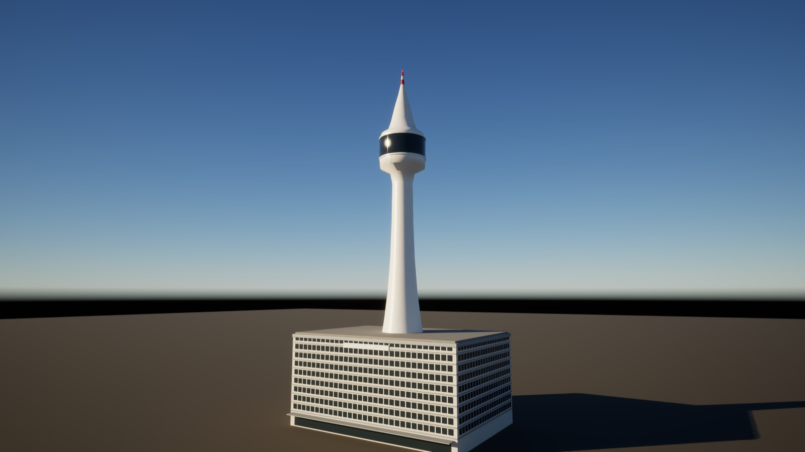

# Kyoto Tower

A sample place for [EarthRT](https://github.com/threert/EarthRT): Kyoto Tower (1964), the white 131 m tower on the
nine-storey Kyoto Tower Building in front of Kyoto Station, as a ThreeRT scene module
([scene/tower.ts](scene/tower.ts)): the EarthRT app's traced view draws it when you come within 600 m (`enterFrom`);
the map shows its baked GLB from the air. Windows, the observation deck and floodlights light up after dusk.

Topic `site:kyoto-tower`: one of two versions in the samples, with
[earth-sample-kyoto-tower-lowpoly](https://github.com/threert/earth-sample-kyoto-tower-lowpoly) (a GLB). EarthRT shows
the one ranked first by likes and stars, and lists the other.

Proportions from public figures (131 m, deck at 100 m, building 31 m) and photographs; everything is made in code: CC0.
Made from [threert/earth-place-template](https://github.com/threert/earth-place-template).
